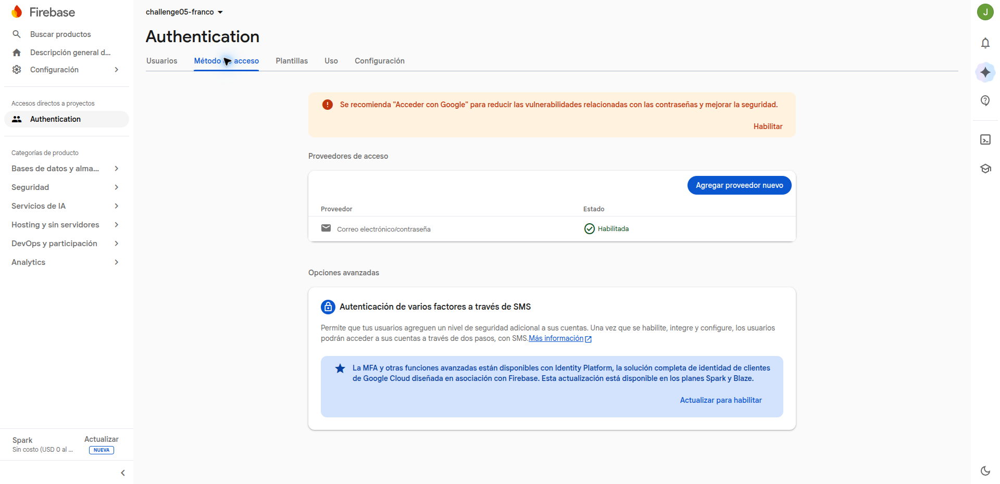
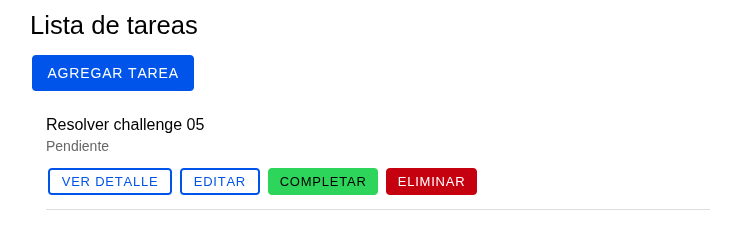

# Challenge 05: gestor de tareas

Aplicación Ionic React en JSX con login, registro y cierre de sesión mediante Firebase Authentication. Incluye lista de tareas, agregar/editar y detalle; permite completar y eliminar tareas.

## Configuración

La autenticación real usa un proyecto Firebase y una app web registrada. Para obtener la configuración:

1. Abre [Firebase Console](https://console.firebase.google.com/) y crea un proyecto. Puedes llamarlo `challenge-05`.
2. Cuando se abra el panel del proyecto, selecciona el icono web `</>` para registrar una app web. Si no lo ves, abre **Configuración del proyecto** y agrega una app.
3. Asigna un nombre a la app, por ejemplo `challenge-05-web`, y regístrala. Para ejecutar este proyecto localmente con `npm run dev`, no necesitas configurar Hosting.
4. Firebase mostrará el objeto `firebaseConfig`. Si ya cerraste esa pantalla, vuelve a **Configuración del proyecto → General → Tus apps** y selecciona la app web.
5. Copia estos cuatro campos del objeto: `apiKey`, `authDomain`, `projectId` y `appId`. Se usan en la tabla de abajo.
6. En Firebase Console, abre **Authentication → Método de acceso** y habilita **Correo electrónico/contraseña**. Guarda el cambio.

En la consola del proyecto usada para validar esta aplicación, Email/Password aparece habilitado:



Desde la carpeta del proyecto, crear el archivo de variables si aún no existe:

```bash
cp -n .env.example .env
```

Completar las variables con los valores del objeto `firebaseConfig` de la app web:

| Variable                    | Campo de Firebase |
| --------------------------- | ----------------- |
| `VITE_FIREBASE_API_KEY`     | `apiKey`          |
| `VITE_FIREBASE_AUTH_DOMAIN` | `authDomain`      |
| `VITE_FIREBASE_PROJECT_ID`  | `projectId`       |
| `VITE_FIREBASE_APP_ID`      | `appId`           |

Reiniciar el servidor después de cambiar `.env`. Sin esta configuración, la aplicación muestra un aviso y no permite autenticarse.

## Ejecutar

Requiere Node.js 22.12 o superior:

Desde la raíz del repositorio, instala las dependencias de la rama activa antes de iniciar. Repite `npm ci` después de cambiar de rama: Git cambia los archivos del proyecto, pero no actualiza `node_modules`. Si el servidor estaba abierto, detenlo con `Ctrl+C` antes de instalar y vuelve a iniciarlo al terminar.

```bash
npm ci
npm run dev
```

Al abrir la app, crea una cuenta en **Crear una cuenta**. Firebase Authentication administra los usuarios. La siguiente captura muestra la lista después de iniciar sesión:



Para generar la versión de producción:

```bash
npm run build
```

## Organización

- `src/firebase/config.js`: inicializa Firebase desde `.env`.
- `src/hooks/useFirebaseAuth.js`: escucha la sesión y ejecuta login, registro y logout con Firebase; gestiona espera y errores.
- `src/context/AuthContext.jsx`: comparte la autenticación entre las páginas.
- `src/context/TasksContext.jsx`: comparte las tareas y sus operaciones entre lista, formulario y detalle.
- `src/pages/`: Login, Register, TasksList, TaskForm y TaskDetail.

Firebase conserva la sesión al recargar. Las tareas se mantienen en memoria durante la sesión de la aplicación: se pierden al recargar o cerrar sesión. Se reinician al cambiar de usuario.

Las rutas de tareas requieren autenticación. El detalle y la edición usan el identificador en la URL y muestran un mensaje si la tarea no existe.

Referencia de autenticación: [Firebase Authentication para web](https://firebase.google.com/docs/auth/web/password-auth).
