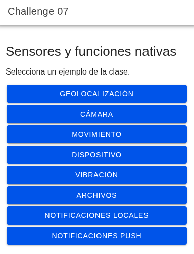

# Challenge 07: sensores

App vacía de Ionic React basada en la diapositiva 42 de `Clase 08 - Sensors.pptx`. El Home abre una página por cada función de la clase y cada página consume su propio custom hook.

## Ejecución web

Requiere Node.js 22.12 o superior y npm.

```bash
npm ci
npm run dev
```

También admite `ionic serve` si Ionic CLI está instalado. No requiere `.env` ni login. Al cambiar desde otra rama, ejecuta `npm ci` para instalar las dependencias de esta entrega.

## Ejemplos

| Página | Acciones |
| --- | --- |
| Geolocalización | Consultar coordenadas, iniciar y detener seguimiento. |
| Cámara | Tomar o elegir una foto y mostrarla. |
| Movimiento | Escuchar aceleración y orientación, mostrar movimiento y agitación. |
| Dispositivo | Consultar modelo, plataforma, sistema, ID y batería disponible. |
| Vibración | Impactos, avisos hápticos y vibración. |
| Archivos | Guardar, leer, listar y eliminar `challenge07/nota.txt` en almacenamiento privado. |
| Notificaciones locales | Solicitar permiso, enviar, programar y cancelar. |
| Notificaciones push | Solicitar permiso, obtener token y mostrar mensajes recibidos o abiertos. |

GPS y movimiento detienen sus suscripciones al salir de la página. Los permisos se solicitan al pulsar las acciones correspondientes.

## Captura

**Inicio:** menú con acceso a cada sensor y función nativa.



En web, geolocalización y movimiento requieren localhost o HTTPS y dependen de los sensores y permisos del navegador. La cámara usa el selector de archivos. Archivos usa almacenamiento del navegador. Batería puede no estar disponible y la vibración requiere hardware compatible. Las notificaciones locales y push de estos plugins se prueban en la app instalada, por lo que sus acciones se deshabilitan en web.

## Android: ejecución en un teléfono por USB

El proyecto nativo está en `android/` y usa el identificador `com.franco.challenge07`. El teléfono debe tener Android 7.0 (API 24) o superior. La app se compila con Android SDK 36.

### 1. Preparar el teléfono

1. Abre **Ajustes → Acerca del teléfono** y pulsa siete veces **Número de compilación**. En Xiaomi/Redmi puede aparecer como **Versión de MIUI** o **Versión del sistema operativo**. Introduce el PIN si se solicita.
2. Entra en **Opciones de desarrollador**; en Xiaomi suele estar en **Ajustes → Ajustes adicionales**.
3. Activa **Depuración USB**. Si el fabricante incluye **Instalar vía USB**, actívalo también y completa la autorización que solicite.
4. Conecta el teléfono con un cable USB que permita transferir datos y mantén la pantalla desbloqueada. Si no se detecta, selecciona **Transferencia de archivos** en las opciones USB.
5. Acepta **Permitir depuración USB** y la huella de la computadora. Esta autorización es independiente de la confirmación de instalación que puede aparecer después.

Consulta la [guía de conexión de Android](https://developer.android.com/studio/run/device) si los nombres de los ajustes difieren.

### 2. Preparar Linux y las herramientas

Instala Android Studio. En **SDK Manager**, comprueba la ruta del SDK y que estén instalados **Android SDK Platform 36**, **Android SDK Build-Tools 36.0.0** y **Android SDK Platform-Tools**. Para usar un teléfono físico no hace falta iniciar un emulador.

Usa un **JDK 21** para compilar este proyecto. En Android Studio se selecciona en **Settings → Build, Execution, Deployment → Build Tools → Gradle → Gradle JDK**. La terminal necesita también `JAVA_HOME`.

Añade este bloque una sola vez a `~/.bashrc` (o `~/.zshrc` si usas Zsh). Ajusta las rutas si tus instalaciones están en otro directorio. La ruta del JDK del ejemplo corresponde al equipo donde se preparó el proyecto:

```bash
export ANDROID_HOME="$HOME/Android/Sdk"
export ANDROID_SDK_ROOT="$ANDROID_HOME"
export JAVA_HOME="$HOME/.jdks/jbr-21.0.11"
export PATH="$JAVA_HOME/bin:$ANDROID_HOME/platform-tools:$ANDROID_HOME/emulator:$PATH"
```

`ANDROID_HOME` identifica el SDK. `ANDROID_SDK_ROOT` se conserva por compatibilidad con herramientas que lo consultan; ambas deben apuntar al mismo directorio. Véase la [referencia de variables de Android](https://developer.android.com/tools/variables).

Recarga Bash y comprueba las herramientas:

```bash
source ~/.bashrc
java -version
adb devices -l
```

El teléfono debe aparecer con estado `device`. Si aparece `unauthorized`, acepta la autorización en su pantalla. Si no aparece, revisa cable, modo USB y permisos del dispositivo en Linux según la guía de Android.

Desde la raíz de este proyecto, instala las dependencias y las herramientas de lanzamiento:

```bash
npm ci
npm install -g @ionic/cli native-run
npx cap run android --list
```

El último comando debe mostrar el teléfono y su identificador. Que `adb` funcione no garantiza que Capacitor encuentre el SDK: si aparece `ERR_SDK_NOT_FOUND`, revisa las variables y abre una terminal nueva.

### 3. Lanzar con recarga en vivo

Conecta el teléfono y la computadora a la misma red Wi-Fi. USB permite instalar la app y depurarla; con `--external`, la app carga el servidor de desarrollo a través de la red.

Ejecuta desde la raíz del proyecto:

```bash
ionic cap run android -l --external
```

Selecciona el teléfono si se muestra una lista. También puedes indicar directamente el identificador que devuelve `npx cap run android --list`:

```bash
ionic cap run android -l --external --target ID_DEL_TELEFONO
```

Mantén el teléfono desbloqueado y acepta **Instalar** cuando aparezca. Si ves `INSTALL_FAILED_USER_RESTRICTED: Install canceled by user`, revisa **Instalar vía USB** y repite el comando prestando atención a esa confirmación.

Deja la terminal abierta: los cambios de React y CSS se reflejan al guardar. Los cambios de plugins, permisos o código Android requieren volver a sincronizar y compilar. Para detener el servidor, pulsa `Ctrl+C`. Esta ejecución depende del servidor de desarrollo; para una instalación autónoma usa el siguiente apartado.

Si la app no alcanza el servidor, comprueba que ambos equipos estén en la misma red, que la red permita comunicación entre ellos y que el cortafuegos permita el puerto que muestra Ionic. No guardes una dirección de desarrollo en `capacitor.config.json` para distribuir la app. Más detalles en [Ionic capacitor run](https://ionicframework.com/docs/cli/commands/capacitor-run) y [Live Reload de Capacitor](https://capacitorjs.com/docs/guides/live-reload).

### 4. Ejecutar sin servidor de desarrollo

Detén primero Live Reload. Comprueba que `capacitor.config.json` no conserve un `server.url` de desarrollo y ejecuta:

```bash
npm run build
npx cap sync android
npx cap run android
```

Selecciona el teléfono y acepta la instalación. La app instalada se abre desde su icono **Challenge 07** y usa los archivos incluidos en el APK. Después de modificar el código, repite estos comandos para actualizarla.

Como alternativa, tras el build y la sincronización, ejecuta `npx cap open android`, abre el proyecto `android/` en Android Studio, espera la sincronización de Gradle y selecciona **app → tu teléfono → Run**.

### 5. Depurar la app

Con la app abierta y el teléfono conectado, abre `chrome://inspect/#devices` en Chrome de la computadora. Activa **Discover USB devices** y pulsa **Inspect** bajo la WebView de la app para acceder a consola, solicitudes de red y puntos de interrupción de JavaScript. Consulta la [guía de depuración remota de Chrome](https://developer.chrome.com/docs/devtools/remote-debugging/).

Para errores de Java/Kotlin o de los plugins nativos, usa el depurador y **Logcat** de Android Studio seleccionando el proceso `com.franco.challenge07`.

Los permisos de ubicación están declarados en el manifiesto. Cámara y notificaciones usan los permisos de sus plugins; concédelos cuando la app los solicite. La entrega de una notificación programada puede retrasarse por las restricciones del sistema.

### Notificaciones push

Para push, registra una app Android con el mismo identificador en Firebase y coloca su `google-services.json` en `android/app/` antes de sincronizar y ejecutar. Ese archivo está excluido de Git. No se utiliza el SDK web de Firebase ni las variables de challenges anteriores. Usa el token mostrado en la página Push para enviar un mensaje de prueba desde Firebase Messaging. Sigue la [configuración oficial del plugin](https://capacitorjs.com/docs/apis/push-notifications).

Este repositorio prepara Android. Para iOS se requiere añadir esa plataforma en macOS y configurar sus permisos y APNs según la documentación de cada plugin.
