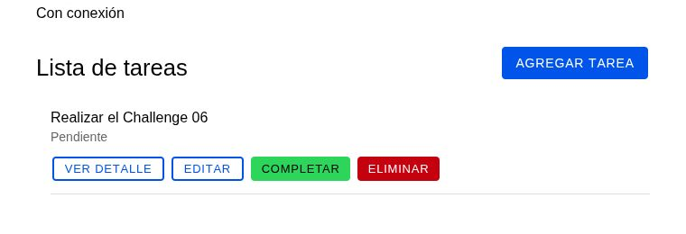
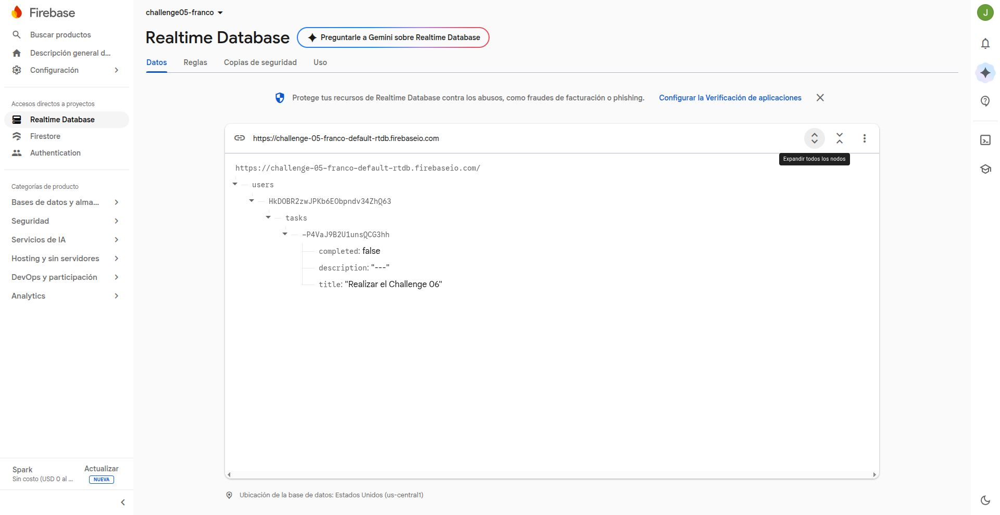
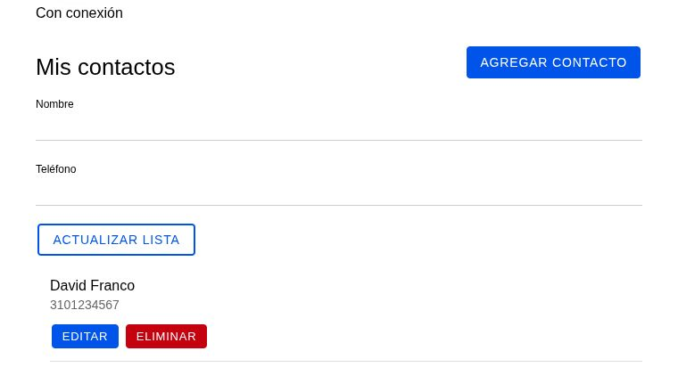
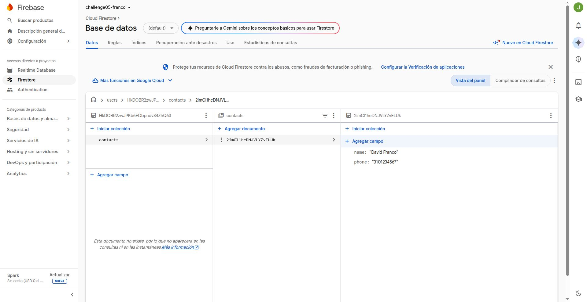
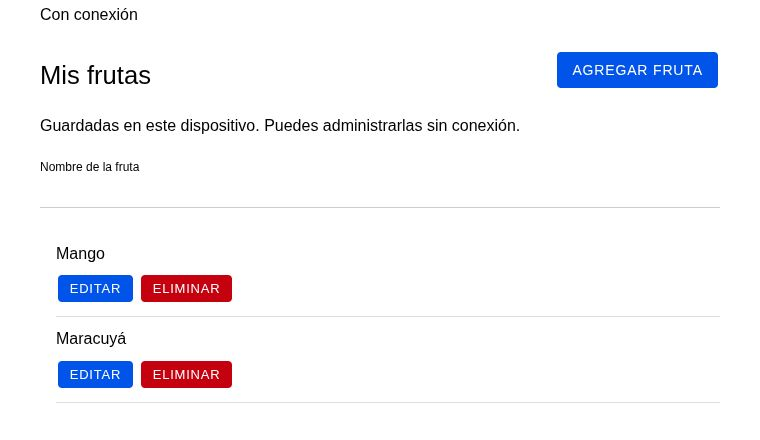

# Challenge 06: contactos, tareas y frutas

App Ionic React con acceso mediante Firebase Authentication y rutas protegidas. Implementa la consigna de la diapositiva 27 de [Clase 07 - Storage_n_Sensors](https://docs.google.com/presentation/d/1VWMOOyL8Rnfx8RxysSYuLlBiN1F8gYkQ/edit).

## Configuración

Requiere Node.js 22.12 o superior y npm. Para ejecutar `ionic serve`, instala Ionic CLI:

```bash
npm install -g @ionic/cli
npm ci
cp -n .env.example .env
```

En `.env`, configura las credenciales de una app web de Firebase:

| Variable | Valor de Firebase |
| --- | --- |
| `VITE_FIREBASE_API_KEY` | `apiKey` |
| `VITE_FIREBASE_AUTH_DOMAIN` | `authDomain` |
| `VITE_FIREBASE_PROJECT_ID` | `projectId` |
| `VITE_FIREBASE_APP_ID` | `appId` |
| `VITE_FIREBASE_DATABASE_URL` | URL de Realtime Database |

Configura Firebase y la conexión de la app en este orden:

1. En Firebase Authentication, habilita **Email/Password**. Asegúrate de tener Cloud Firestore y Realtime Database en el proyecto.
2. En **Firestore Database → Rules**, reemplaza las reglas actuales por estas y pulsa **Publish**. Esto quita el acceso abierto temporal que permite a cualquiera leer y modificar datos.

   ```text
   rules_version = '2';

   service cloud.firestore {
     match /databases/{database}/documents {
       match /users/{userId}/contacts/{contactId} {
         allow read, write: if request.auth != null && request.auth.uid == userId;
       }
     }
   }
   ```

   El usuario debe iniciar sesión y solo puede acceder a los contactos guardados bajo su propio `uid`. Las demás rutas de Firestore quedan sin acceso desde la app. Si otras apps usan ese Firestore, agrega reglas específicas para ellas.
3. En **Realtime Database**, crea la base si aún no existe y selecciona una región.
4. En **Realtime Database → Rules**, reemplaza las reglas actuales por este bloque y pulsa **Publish**:

   ```json
   {
     "rules": {
       "users": {
         "$uid": {
           "tasks": {
             ".read": "auth != null && auth.uid === $uid",
             ".write": "auth != null && auth.uid === $uid"
           }
         }
       }
     }
   }
   ```

   Solo el usuario autenticado cuyo `uid` coincide con `$uid` puede leer o cambiar tareas bajo `users/{uid}/tasks`. Las demás rutas siguen denegadas. Si otras apps usan esta base, agrega reglas específicas para sus rutas, sin permisos globales en la raíz. El bloque también está en [`database.rules.json`](database.rules.json). Firebase explica [cómo funcionan las reglas de Realtime Database](https://firebase.google.com/docs/database/security/core-syntax).
5. Completa en `.env` las cuatro variables de la app web de Firebase indicadas arriba.
6. En el mismo `.env`, establece la URL de Realtime Database:

   ```dotenv
   VITE_FIREBASE_DATABASE_URL=https://challenge-05-franco-default-rtdb.firebaseio.com/
   ```

Reinicia el servidor después de cambiar `.env`. Inicia la app desde la raíz del proyecto:

```bash
ionic serve
```

También puedes usar `npm run dev`. Al volver a esta rama desde otro challenge, ejecuta `npm ci` antes de iniciar la app para instalar las dependencias correspondientes.

## Uso

Crea una cuenta o inicia sesión. La barra de navegación abre estas secciones:

- **Contactos:** agrega, consulta, edita y elimina contactos con nombre y teléfono. Se guardan en Cloud Firestore.
- **Tareas:** agrega, consulta, edita, completa y elimina tareas. Se guardan en Realtime Database y los cambios se reflejan en tiempo real.
- **Frutas:** agrega, edita y elimina frutas por nombre. Se guardan localmente en el dispositivo con Dexie.

La app muestra el estado de conexión y deshabilita las acciones de contactos y tareas cuando el dispositivo está sin conexión. Las frutas siguen disponibles sin conexión mientras la app esté abierta y haya una sesión iniciada. Los contactos y tareas se separan por usuario. Las frutas permanecen en el dispositivo entre sesiones, pero cada cuenta ve solo las propias.

## Capturas

**Tareas:** lista con las acciones para consultar, editar, completar y eliminar cada tarea.



**Realtime Database:** la misma tarea almacenada bajo `users/{uid}/tasks`.



**Contactos:** formulario de nombre y teléfono y lista de contactos guardados.



**Cloud Firestore:** documento del contacto con los campos `name` y `phone` dentro de `users/{uid}/contacts`.



**Frutas:** lista de frutas guardadas en el dispositivo con Dexie.


