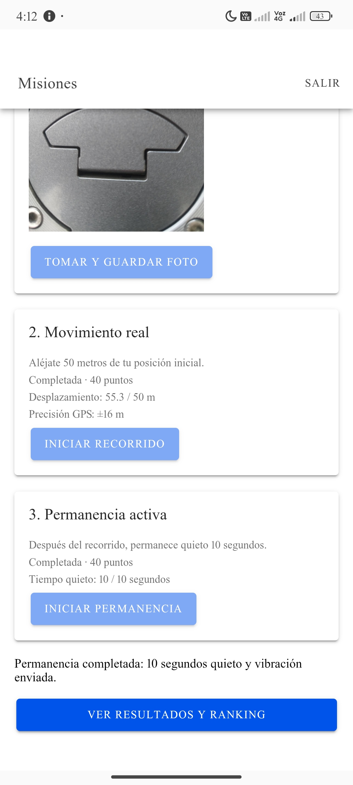
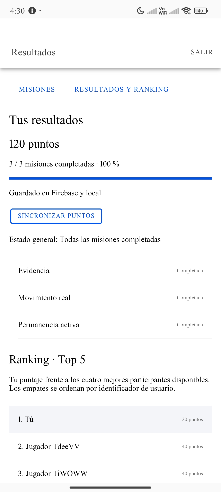
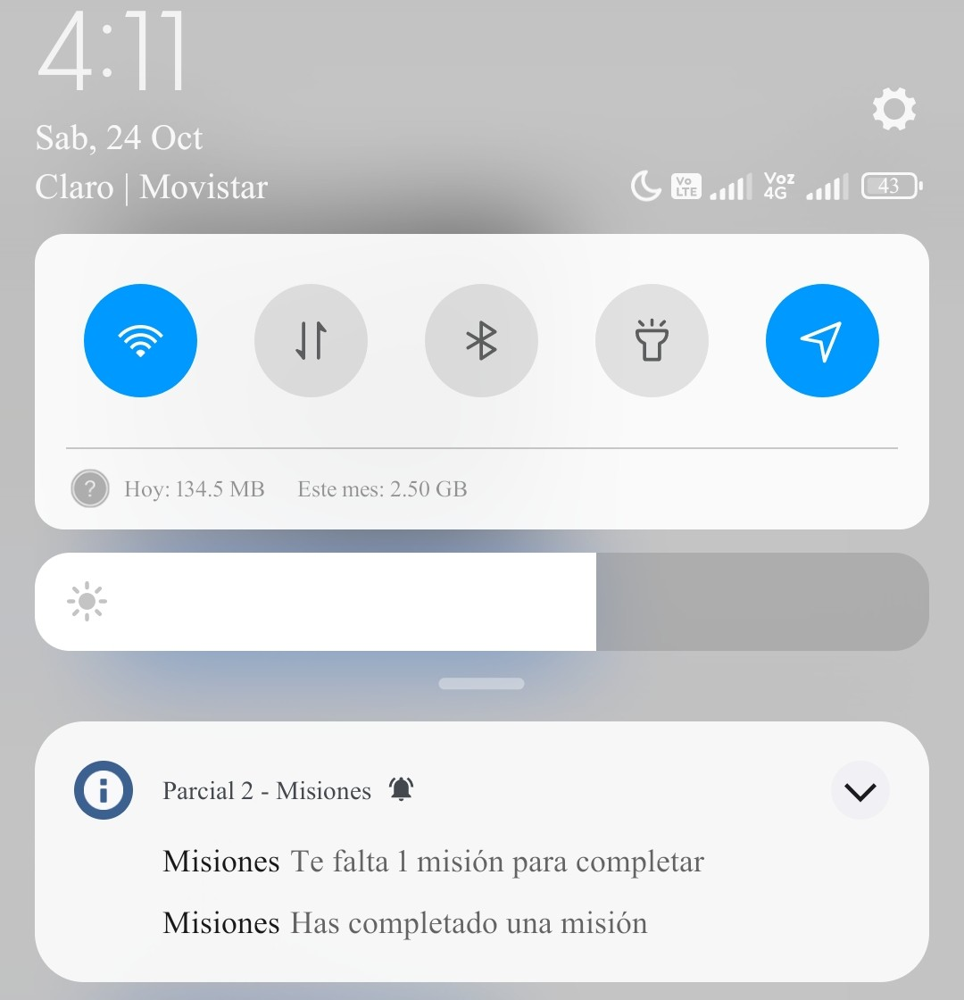

# Parcial 2 · Misiones

App Ionic + React en la que cada usuario se registra o inicia sesión con Firebase, completa tres misiones y consulta su progreso y ranking.

## Capturas de pantalla

| Misiones completadas                                                                                                 | Resultados y ranking                                                                                                             | Notificaciones locales                                                                                              |
| -------------------------------------------------------------------------------------------------------------------- | -------------------------------------------------------------------------------------------------------------------------------- | ------------------------------------------------------------------------------------------------------------------- |
|  |  |  |

## Requisitos

- Git.
- Node.js 22 o superior y npm.
- Conexión a internet para registrarse, iniciar sesión y sincronizar los resultados.
- Para las misiones nativas: teléfono Android con cámara, ubicación precisa, acelerómetro y vibrador, con depuración USB habilitada. Para compilar: JDK 21 y Android SDK 36.

## Instalación y ejecución

Clona el repositorio y selecciona la rama del parcial:

```bash
git clone https://github.com/90sfranco/DESARROLLO_MOVIL.git
cd DESARROLLO_MOVIL
git switch parcial-2-john-franco
npm ci
```

Para ejecutar en el navegador:

```bash
npm run dev
```

Abre la dirección local que muestre Vite y crea una cuenta o inicia sesión. La conexión con Firebase ya está configurada.

Al cambiar de rama, ejecuta otra vez `npm ci` antes de iniciar la app.

## Android

Después de instalar las dependencias, conecta el teléfono por USB, habilita la depuración USB y acepta la autorización del equipo en el teléfono. Desde la raíz del proyecto:

```bash
adb devices
npm run build
npx cap sync android
npx cap run android
```

`ANDROID_SDK_ROOT` debe apuntar al SDK instalado. También puedes abrir el proyecto nativo con `npx cap open android`.

## Uso

1. Crea una cuenta o inicia sesión con correo y contraseña.
2. Activa las notificaciones y acepta el permiso en Android. El mismo botón permite desactivar los avisos de la app.
3. **Evidencia:** toma una foto y confirma la captura. La misión se completa después de guardar el archivo en el almacenamiento privado de la app.
4. **Movimiento real:** inicia el recorrido al aire libre, permite la ubicación precisa y aléjate 50 metros del punto inicial. Se usa la distancia geográfica al origen, no la suma de pasos. Las lecturas con precisión peor que 20 metros se descartan.
5. **Permanencia activa:** tras completar el recorrido, inicia la misión y mantén el teléfono quieto durante 10 segundos. Si se mueve o se interrumpen las lecturas del acelerómetro, el contador se reinicia. Al completarse se solicita una vibración.
6. Consulta **Resultados y ranking** para ver puntos, misiones y estado general.

Cada misión entrega 40 puntos una única vez, hasta un máximo de 120.

## Datos y ranking

El ranking compara al usuario actual con los cuatro mejores participantes disponibles, ordenados por puntos. Los empates se resuelven por identificador. Si hay menos de cinco participantes, muestra los disponibles e indica cuántos faltan. Cada participante necesita una cuenta real y haber ingresado a esta app para publicar su puntuación.

Los puntos se calculan a partir de las misiones completadas. La sincronización combina el progreso local y remoto mediante una transacción para conservar avances y evitar duplicados. Si no hay conexión, las misiones se guardan en local y aparece el envío pendiente. Al recuperar conexión o pulsar **Sincronizar puntos**, se reintenta el envío. El acceso inicial requiere conexión con Firebase.

En el navegador se pueden revisar el registro, el inicio de sesión, el progreso y los resultados. La captura web depende del selector de cámara del navegador. Las notificaciones locales y la comprobación de todos los sensores deben realizarse en Android.
